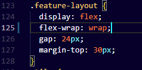
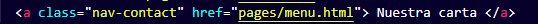
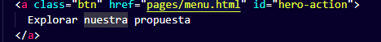
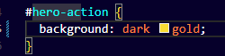
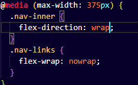

# SAVIA — examen N.º 1

Proyecto estático HTML + CSS. Abrir `index.html` en el navegador. No necesita dependencias.

El sitio incluye la página Inicio y las plantillas `pages/menu.html`, `pages/equipo.html` y `pages/eventos.html` con contenido central pendiente. Siga exclusivamente las especificaciones del examen para conocer el comportamiento esperado. No modifique el tema general ni sustituya el proyecto por otro.

## Diagnóstico de cinco incidencias

| N.º | Comportamiento observado                                                                 | Causa técnica y ubicación                                                                                                                                     | Corrección realizada                                              | Prueba de verificación   | Autor                       |
| --- | ---------------------------------------------------------------------------------------- | ------------------------------------------------------------------------------------------------------------------------------------------------------------- | ----------------------------------------------------------------- | ------------------------ | --------------------------- |
| 1   | Las cards estaban distribuidas en columna y se solicita que esten una seguida de la otra | El flex estaba en column en lugar de row, ubicado en styles.css, linea 124: display: flex; flex-direction: column;                                            | display: flex;flex-wrap: wrap;                                    |  | Gerald Urbina               |
| 2   | El boton redirige a la pagina incorrecta                                                 | Era por que el href tenia una ruta incorrecta: <a class="nav-contact" href="pages/eventos.html"> Nuestra carta </a>, este error estaba en index.html linea 15 | <a class="nav-contact" href="pages/menu.html"> Nuestra carta </a> |    | Luis Felipe Ortega Bolaños  |
| 3   | El boton "Explora nuestra propuesta no redirigia a nada"                                 | El href de ese boton no tenia ruta, index.html, linea 30                                                                                                      | Se le puso la ruta de la pagina deseada                           |  | Luis Felipe Ortega Bolaños  |
| 4   | El boton "Explora nuestra propuesta" estaba en rojo                                      | En css estaba en rojo, styles.css, linea 245                                                                                                                  | Se cambió a dorado                                                |  | Gerald Urbina Quesada       |
| 5   | La navegacion no se mostraba abajo del logo como se pedia                                | en el styles estaba como: flex-direction: row; ubicacion: styles.css, linea 249                                                                               | la linea se cambio a flex-wrap: wrap;                             |  | Luis Felipe y Gerald Urbina |

## Responsables de las funcionalidades

| Estudiante                 | Página asignada | Rama   | Commits principales                                             |
| -------------------------- | --------------- | ------ | --------------------------------------------------------------- |
| Luis Felipe Ortega Bolaños | menu.html       | ramaf1 | La pagina de menu completa y funcional junto al css que utiliza |

## Evidencias Git

| Funcionalidad/corrección | PR hacia develop | Revisor | Resultado de merge / conflicto si ocurrió |
| ------------------------ | ---------------- | ------- | ----------------------------------------- |
|                          |                  |         |                                           |

## Verificación final

Registrar las pruebas de funcionamiento a 1280 px y 375 px, enlaces y páginas.
